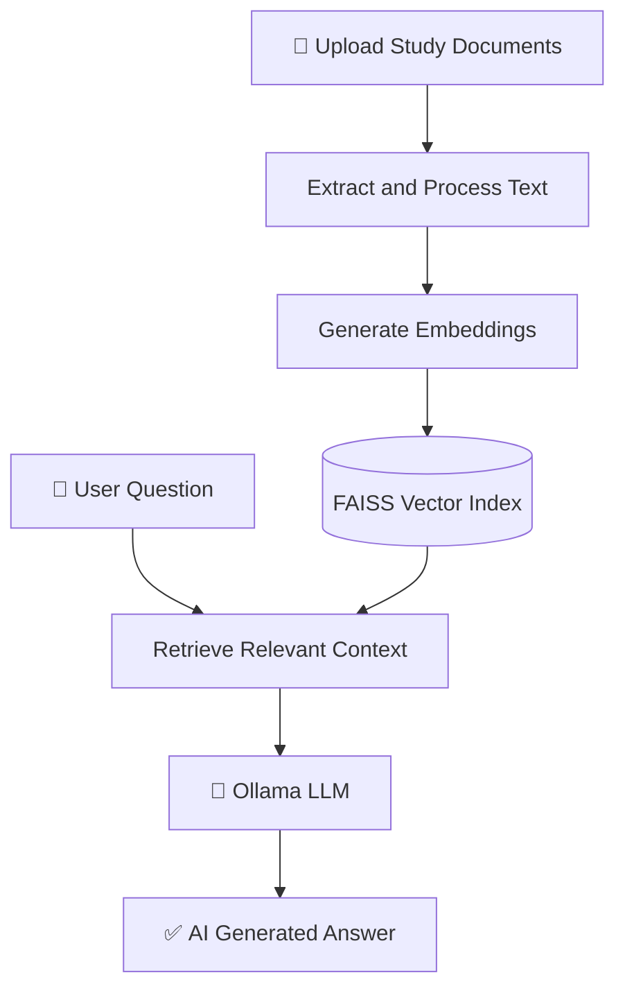

# 🧠 RAG AI Teaching Assistant

<p align="center">
  
  
</p>

<h3 align="center">
  📚 Your Study Materials. Your AI Assistant.
</h3>

<p align="center">
  An AI-powered learning assistant that answers questions using your uploaded documents through Retrieval-Augmented Generation (RAG).
</p>

<p align="center">
  <a href="https://github.com/harshraghav766/my-rag-ai-assistance">
    
  </a>
  
  
  
  
</p>

---

## ✨ About the Project

**RAG AI Teaching Assistant** is a Python-based AI project designed to make learning easier with document-based question answering.

Instead of searching through lengthy notes manually, users can upload supported study materials and ask questions in natural language. The system retrieves relevant content from its knowledge base and uses an LLM to generate contextual answers.

> 🎯 **Goal:** Make educational content easier to search, understand, and interact with using AI.

## 🚀 Features

<table>
  <tr>
    <td width="50%">
      <h3>📄 Document Upload</h3>
      Upload supported study materials and build a personal knowledge base.
    </td>
    <td width="50%">
      <h3>🧠 RAG Pipeline</h3>
      Retrieve relevant document context before generating answers.
    </td>
  </tr>
  <tr>
    <td width="50%">
      <h3>🔎 Semantic Retrieval</h3>
      Use embeddings and FAISS for vector similarity search.
    </td>
    <td width="50%">
      <h3>💬 AI Chat Interface</h3>
      Interact with your documents through a Streamlit interface.
    </td>
  </tr>
  <tr>
    <td width="50%">
      <h3>🤖 Local LLM</h3>
      Run supported language models locally using Ollama.
    </td>
    <td width="50%">
      <h3>🔐 Privacy-Focused</h3>
      Keep documents and inference local when using the local configuration.
    </td>
  </tr>
</table>

## 🛠️ Tech Stack

<p align="center">
  
  
  
</p>

<p align="center">
  
  
  
</p>

| Technology | Role |
|---|---|
| Python | Application logic |
| Streamlit | Interactive user interface |
| Ollama | Local language model inference |
| FAISS | Vector similarity search |
| Embeddings | Numerical representation of text |
| RAG | Context-aware question answering |

## ⚙️ How It Works



1. Upload documents.
2. Process the document content.
3. Create vector embeddings.
4. Store and search vectors using FAISS.
5. Retrieve relevant context for a question.
6. Generate a contextual response using the LLM.

## 💻 Installation & Setup

### 1. Clone the repository

```bash
git clone https://github.com/harshraghav766/my-rag-ai-assistance.git
cd my-rag-ai-assistance
```

### 2. Install dependencies

```bash
python -m pip install -r requirements.txt
```

### 3. Install and configure Ollama

Download Ollama from [ollama.com/download](https://ollama.com/download).

For the current local configuration:

```bash
ollama pull llama3.2:1b
ollama pull nomic-embed-text
```

### 4. Run the application

```bash
python -m streamlit run app.py
```

Open the local address shown in the terminal, usually:

`http://localhost:8501`

> ⚠️ These instructions assume the repository contains `app.py` and `requirements.txt` and that the application uses the specified Ollama models.

## 📂 Project Structure

```text
my-rag-ai-assistance/
│
├── app.py
├── requirements.txt
├── README.md
├── .gitignore
├── data/          # Local document storage, if configured
└── storage/       # Generated vector index, if configured
```

The actual structure depends on the files included in the repository.

## 🔮 Future Roadmap

- [ ] Deploy a public online demo.
- [ ] Add source references to generated answers.
- [ ] Improve document retrieval and ranking.
- [ ] Add chat history and session management.
- [ ] Expand support for document formats.
- [ ] Improve the interface and user experience.

## 👨‍💻 Developer

<p align="center">
  
  
</p>

<p align="center">
  BCA Student • Python Developer • Aspiring Data Scientist
</p>

<p align="center">
  <a href="https://github.com/harshraghav766">
    
  </a>
  <a href="https://github.com/harshraghav766/my-rag-ai-assistance">
    
  </a>
</p>

---

<p align="center">
  ⭐ If you find this project interesting, consider starring the repository!
  <br/>
  <b>Built with Python, curiosity, and a passion for AI. 🚀</b>
</p>
